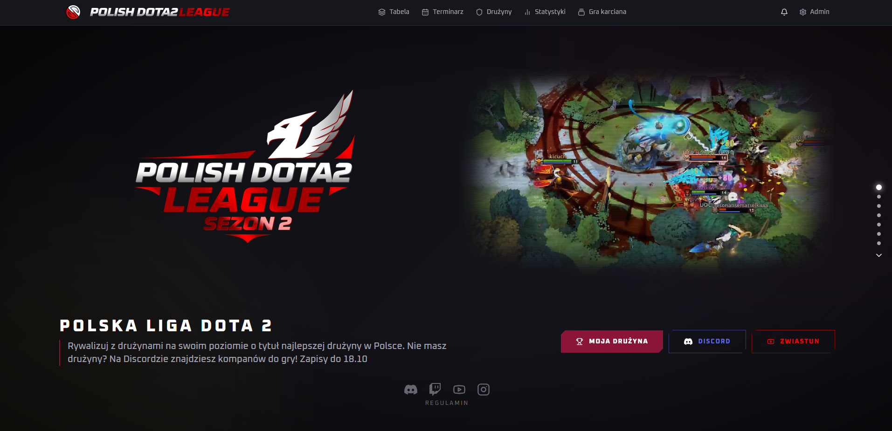
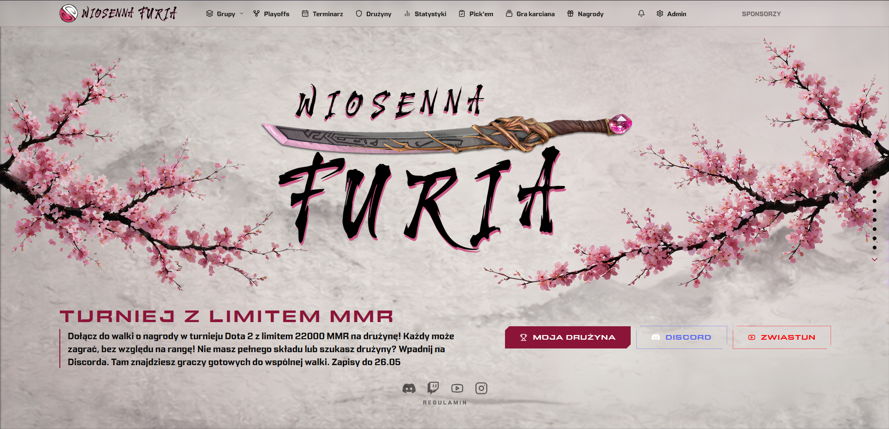
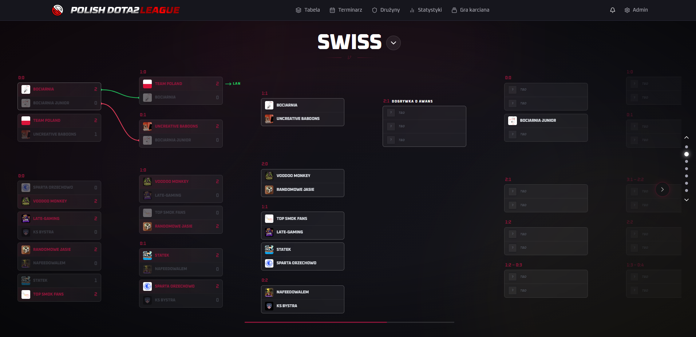
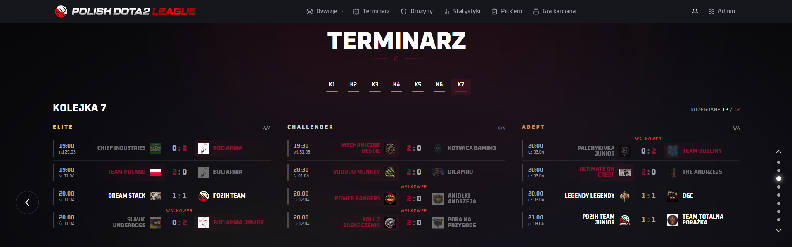
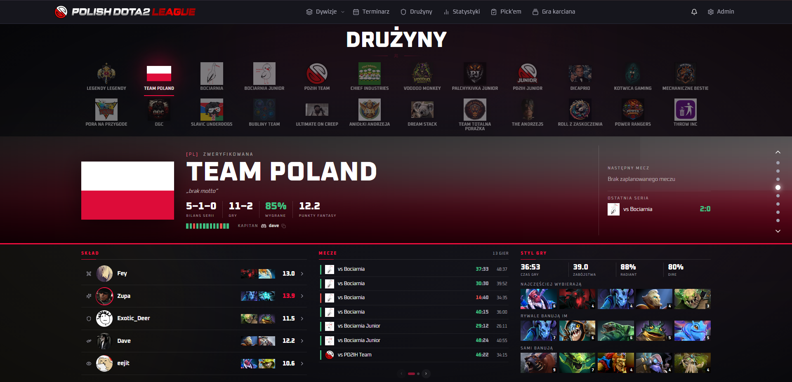
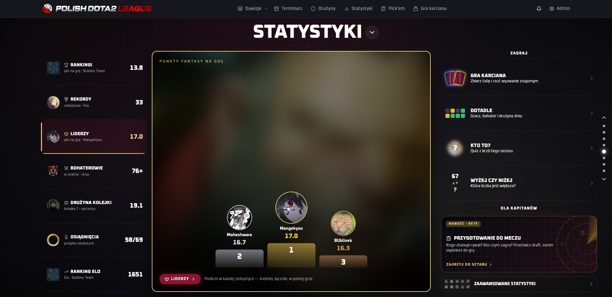
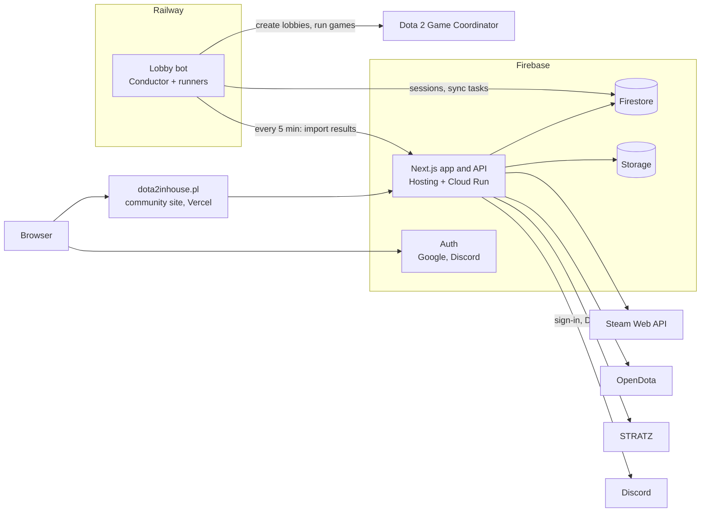

# dota2inhouse.pl: tournament platform for a Dota 2 community

The platform that runs the leagues of the Polish Dota 2 Inhouse community (about 2,500 people on Discord). This repository is a public showcase. The code itself is private.

**Live:** https://dota2inhouse.pl

## What it does

On match day nobody has to type anything in. About 10 minutes before a scheduled match, a bot creates a private Dota 2 lobby and invites both teams, including approved stand-ins. It runs the ready check and starts each game. When a game ends, the server finds it in the league through the Steam Web API, pulls the details from OpenDota, matches it to the right fixture by the players' Steam ids, and updates the series score, standings, bracket, stats and fantasy points.

Around that core:

- **Tournament creator.** An allowlisted organizer picks a template (MMR-limited groups with playoffs, a league with divisions and promotion, or Swiss), sets up the branding and gets a draft tournament.
- **Branding per tournament.** Colours, fonts, backgrounds, logos and a hero video, applied as a theme.
- **Registration.** Captains register a team with five Steam profiles. The server resolves them through the Steam API, checks Discord server membership, and an admin approves the team.
- **Swiss system.** Points per game won and Buchholz tie-breaks. A pairing search scores every possible pair (rematches, score gaps, MMR gaps, byes) and picks the cheapest full pairing.
- **Stats hub.** Records, player and team pages, hero stats, a team Elo timeline and shareable stat images.
- **Draft prep.** Before a match, a captain sees which heroes each opponent is likely to pick and how each pick or ban changes the win chance. It uses OpenDota and STRATZ data.
- **Card game.** Every real series a player plays becomes a collectible card rated from their performance. Users build decks and play duels with an Elo ranking.
- Stand-in requests, reschedule requests, playoff brackets, Discord notifications, tools for casters and an AI rules assistant (Gemini) with daily quotas.

**In use since 2025:** 4 league seasons, 84 teams, 290 matches and 533 games, with about 4,500 player performance records.

## Screenshots (live site)

The same platform with a different tournament theme (Wiosenna Furia):

Swiss stage with results filled in automatically:

Schedule of one league round across three divisions:

Team page with roster, imported games and play style:

Stats hub with fantasy leaders, records, Elo and mini-games:

## How it is built

- **Frontend and server:** Next.js 15 (App Router) and React in TypeScript, Tailwind and shadcn/ui. Server logic runs as Next.js API routes on Firebase Hosting with Cloud Run.
- **Data:** Firestore, Firebase Auth (Google, and Discord through server-issued custom tokens), Firebase Storage. Steam accounts are linked through Steam OpenID.
- **Lobby bot:** a Node service on Railway that uses `steam-user` and the `dota2` Game Coordinator client.
- **Integrations:** Steam Web API, OpenDota, STRATZ, Discord, Google Gemini, Twitch and Bunny Stream. All keys live in server-side environment variables.

### Who can do what

| Role | What they can do |
|---|---|
| Super admin | Everything, including the bot's Steam accounts |
| Tournament creator | Use the creation wizard (an allowlist, kept separate from admin rights) |
| Organizer / tournament admin | Run one tournament: teams, schedule, results, the bot |
| Captain | Manage their team, request reschedules and stand-ins, use draft prep |
| Signed-in user | Fantasy, pick'em, the card game, stand-in sign-up |
| Viewer | Read everything public |

## Now: a rebuild

Since November 2026 the platform is being rebuilt (not live yet). Data moves from Firestore to PostgreSQL with a 50-table schema in which every tournament row is isolated by design and the bot has its own least-privilege database role. Every write will go through one server-side permission check with an audit log. The rebuild already has a GitHub Actions pipeline (typecheck, lint, about 600 website tests and 100 bot tests, Docker build) and 17 written architecture decision records.

## My role

I designed the product, its logic and the data model, made the architecture decisions, and tested everything with real leagues. I also run those leagues. The code was written by AI tools under my direction: Firebase Studio with Gemini at the start, then GitHub Copilot, now Claude. For the rebuild I organised the AI work like a small team: a brief with hard limits, one branch per work package, separate agents for building and reviewing, and a status file with my decisions.
